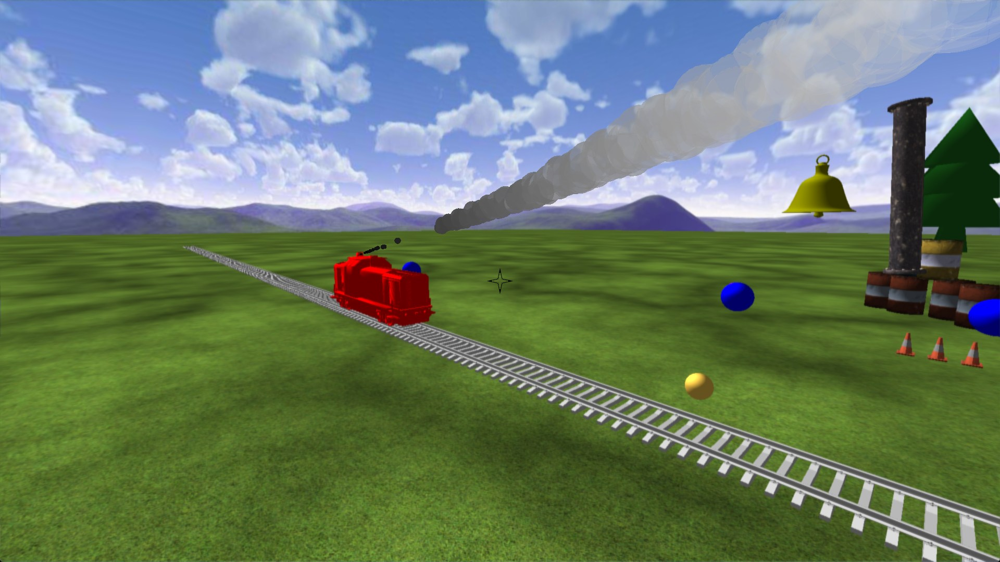
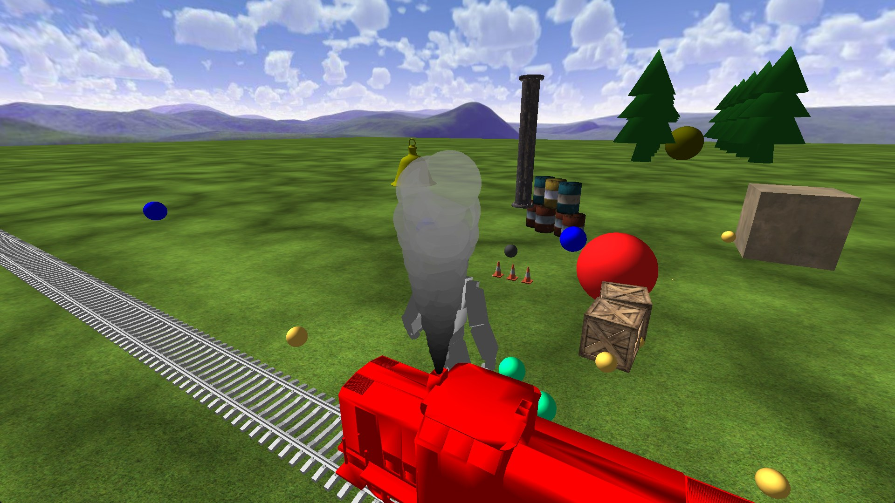
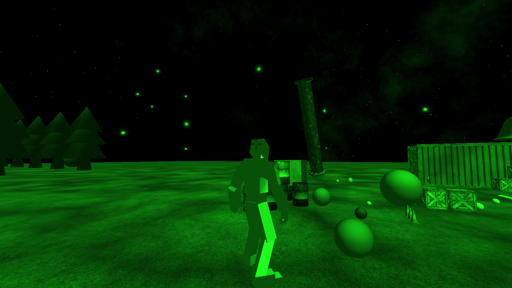
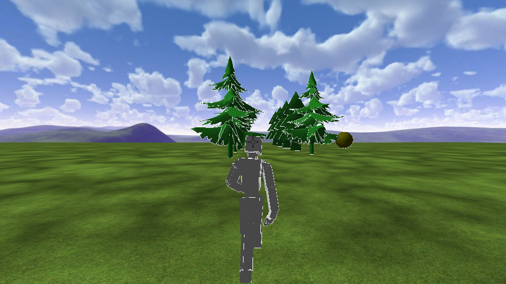
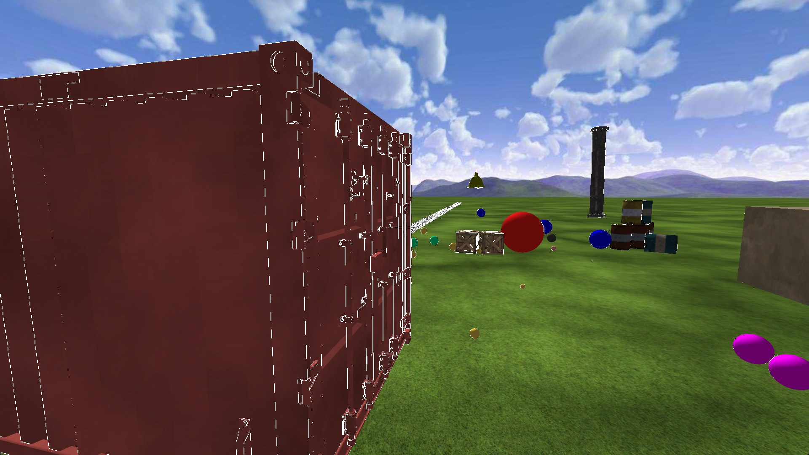

# OpenGL 3D Game Engine

A 3D game engine and technical demo in C++, OpenGL, and GLSL, built for my final project in the Game Development Advanced Programming program at Fanshawe College (2020).

- **[Watch the video](https://www.youtube.com/watch?v=MybYtcnmgkM)**: a walkthrough of the features
- **[Download the playable demo](https://richyrich515.itch.io/richard-woods-gamejam-techdemo)**: Windows build on itch.io

## Features

- **Deferred rendering:** opaque objects go to color, normal, world position, and depth buffers, lighting is applied in a second pass, and transparent objects are rendered last
- **Skeletal animation:** walking, strafing, backwalking, falling, and dancing, chosen by player input and state
- **Level of detail:** swaps to lower-resolution models at a distance to reduce GPU load
- **Particles:** transparent smoke, blended over the deferred scene
- **Post-processing:** edge detection, two-pass full-screen blur with a 7-length kernel, and night vision
- **Texture macrovariation:** modulates a texture with a second texture to hide repeating patterns
- **Uber shader:** all rendering runs through one shader program ([vertex](GDP2019_20/assets/shaders/vertexShader01.glsl), [fragment](GDP2019_20/assets/shaders/fragmentShader01.glsl))
- **Physics:** Bullet Physics, loaded at runtime from a DLL behind a physics interface

## Screenshots

**Transparent smoke, rendered after the deferred lighting pass**

**Night vision post-processing**

**Level of detail and edge detection:** detailed trees near the camera, lower-resolution trees farther back

**Edge detection on a detailed model**

## Controls

| Key | Action |
|---|---|
| WASD | Move |
| Space | Jump |
| Left Click | Shoot |
| E | Dance (third person) |
| C | Toggle first/third person |
| V | Toggle edge detection (`<` and `>` change the threshold) |
| B | Toggle blur |
| N | Toggle night vision |
| ~ | Debug information |

## Building

Open `GDP2019_20.sln` in Visual Studio 2019 and build **Release x64**. Debug x64 also works, but performance is poor.

## Credits

Started from starter code provided in the course. Uses third-party libraries including Bullet Physics, Assimp, and Dear ImGui.
